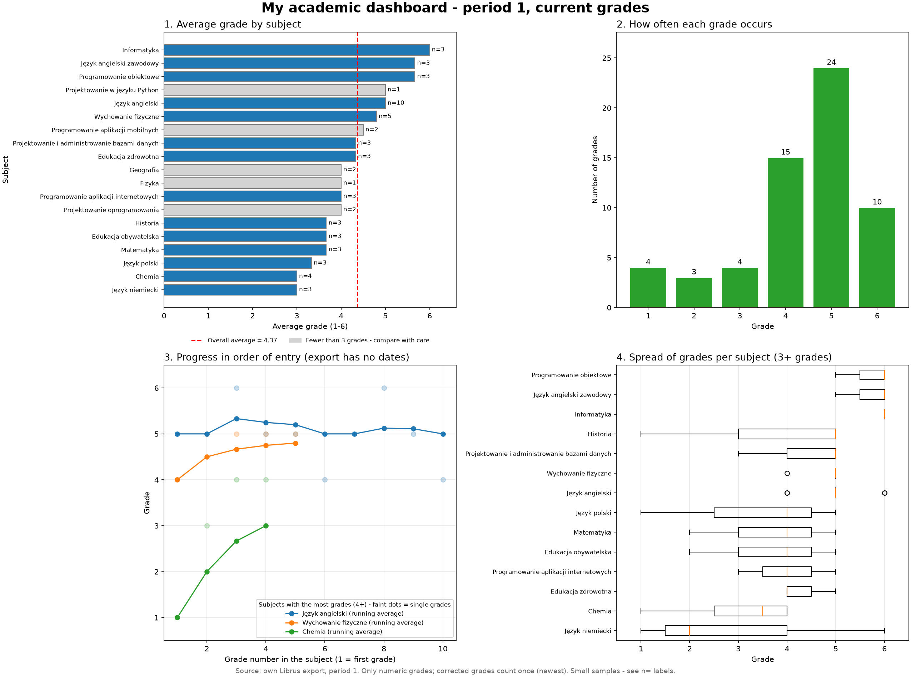

# My Grades – Personal Learning Analytics Dashboard

**Question:** What does my academic performance look like, how has it changed over
time, and which subjects may deserve more attention?



## Quick start: any Librus PDF → website in one command

Works for any student: subjects, periods and grade counts are read from the PDF.

```bash
pip install -r requirements.txt
python make_report.py "LIBRUS Synergia.pdf"
```

This reads the PDF, cleans the grades, runs the analysis and opens the website
in your browser. Everything goes into one folder, `<pdf name>_report/`:

| File | What it is |
|---|---|
| `index.html` | The website: key numbers, dashboard, subject summary, grade alerts, data notes (works offline) |
| `dashboard.png` | The 2×2 dashboard |
| `grades.csv` | Cleaned grades, one row per subject |
| `grades_raw.csv` | One row per grade |

Options:

| Option | What it does |
|---|---|
| `-o FOLDER` | Choose the output folder |
| `--plus 0.5 --minus 0.25` | Count `4+` as 4.5 and `4-` as 3.75. Without these, grades with +/- are left out and listed, because their value has to be agreed with the teacher |
| `--no-open` | Don't open the browser |
| `--sep ";"` | Use `;` in `grades.csv` (opens nicely in Polish Excel) |

If the PDF has no text (a scan) or isn't a Librus "Oceny ucznia" export, the script
stops with a clear message instead of making a wrong dataset.

## Files

| File | What it does | Share? |
|---|---|---|
| `make_report.py` | The one-command pipeline: PDF → report folder → browser | yes |
| `pdf_to_csv.py` | Steps 1–3: reads the Librus PDF with pdfplumber and cleans the grades. Also usable on its own: `python pdf_to_csv.py file.pdf -o synergia.csv` | yes |
| `analyse_grades.py` | Steps 3–6: one row per grade, validation, pandas summary, 2×2 dashboard, grade alerts, HTML page. On its own: `python analyse_grades.py [--csv file.csv] [--out-dir folder]` | yes |
| `charts/my_academic_dashboard.png` | The dashboard (no name or student ID on it) | yes |
| `my_academic_dashboard.html` | The web page for my data | yes, same data as the dashboard plus min/max per subject |
| `synergia.csv`, `grades_raw.csv`, `*_report/`, the PDF | Raw grades | **no** – listed in `.gitignore` |

The step-by-step way (same result as `make_report.py`):

```bash
python pdf_to_csv.py "LIBRUS Synergia.pdf" -o synergia.csv
python analyse_grades.py
open my_academic_dashboard.html
```

## Assumptions and decisions

### Grade mapping
- Only the grades `1`–`6` are turned into numbers (`grade_value` = 1.0–6.0).
  `grade_raw` keeps the original text.
- Grades with a plus or minus (`4+`, `3-`) would **not** be guessed. They would
  stay without a number and be printed as "could not be mapped". My export had none.
- **Corrected grades** (`[ old new ]` in Librus) count once, as the newest grade,
  because that is the grade that counts now. Example: `[ - 1 ]` → `1`.

### Missing data and non-grade marks
- `np`, `nb`, `bz`, `T` and lone `+` / `-` marks are **not grades**. They are
  removed, never turned into 0, because a 0 would wrongly pull averages down.
- "Brak ocen" and `-` cells became empty cells.
- 10 of 29 subjects (mostly vocational subjects) have no grades yet. They show
  as INSUFFICIENT DATA in the alert table and are left out of the charts.
- Behaviour (Zachowanie) is not a subject with grades, so it is left out.

### Dates
- **The export has no dates or categories for single grades.** The `date` and
  `category` columns exist in `grades_raw.csv` but are empty. No dates were invented.
- Period 2 has no grades yet in my export, so the "first vs latest period" comparison
  is not possible yet. The scripts use period 2 automatically once it has grades.
- Instead of a monthly trend, chart 3 shows the **running average in the order the
  grades were added**. Librus lists current grades in order of entry, so the order
  is real, but the spacing between grades is unknown.
  Only subjects with 4+ grades are shown.

### Small samples
- Most subjects have only 3 grades. Chart 1 shows `n=` next to every bar, and
  subjects with fewer than 3 grades are grey.
- The box plot only shows subjects with 3+ grades. The HIGH VARIABILITY alert
  needs 4+ grades.

## Three findings

1. **Most grades are good, and 5 is the most common grade.** 49 of 60 grades (82%)
   are 4 or higher, 5 makes up 40% of all grades, and the overall median is 5 (mean 4.37).
   Only 7 grades are 1 or 2.
2. **The IT and vocational subjects are the strongest.** Informatyka, Programowanie
   obiektowe and Język angielski zawodowy all average above 5.5, and their box
   plots are narrow, so the high result is consistent.
3. **Some low averages come from a single low grade, not from consistently low
   results.** In Historia and Język polski one grade of 1 pulls the average below
   the median (Historia: average 3.67, median 5). The box plot shows this, while
   the bar chart alone would hide it. Język niemiecki is different: two of its
   three grades are low (median 2), so it is the subject that most deserves a
   closer look. Chemia started with a 1, then the running average rose
   steadily to 3.0.

## Grade alerts (extension)

`analyse_grades.py` prints a review flag for each subject. A flag means "look
closer", not a prediction or a school grade.

| Flag | Rule |
|---|---|
| INSUFFICIENT DATA | fewer than 3 numeric grades |
| REVIEW AVERAGE | average below 3.0 |
| RECENT DECLINE | the later period averages at least 0.5 lower than the earlier one (2+ grades in each). With only one period: 6+ grades and the newer half at least 0.5 lower than the older half |
| HIGH VARIABILITY | 4+ grades and standard deviation above 1.5 |

Result: only INSUFFICIENT DATA flags (15 subjects: 10 with no grades, 5 with 1–2). No subject
has an average below 3.0. Chemia and Język niemiecki sit exactly at 3.0, so
they are close to the line.

## Limitation

There are no dates, so this is a snapshot of the first weeks of period 1,
not a real trend over time. With about 3 grades per subject, a single grade
changes an average by up to 1.7 points. The numbers are not comparable
between subjects with 3 and 10 grades, so no subject should be called
"weak" from this data.

## 2–3 minute explanation – talking points

- **Pattern:** some low averages (Historia, Język polski) come from a single 1,
  while Język niemiecki is low across its grades.
- **Which chart showed it:** the box plot. For Historia its median line sits far
  from the average shown in the bar chart, and for Język niemiecki it doesn't.
- **What not to conclude:** that Chemia or Język niemiecki is a "failing"
  subject. There are 3–4 grades and no dates.
- **Limitation:** there are no dates and period 2 is empty, so chart 3 shows the
  order of entry instead of time.
